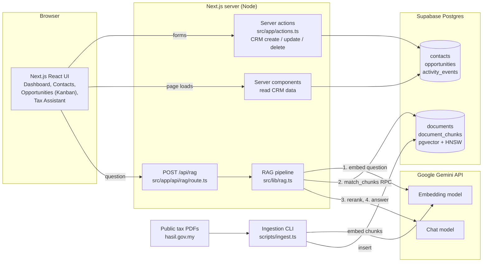
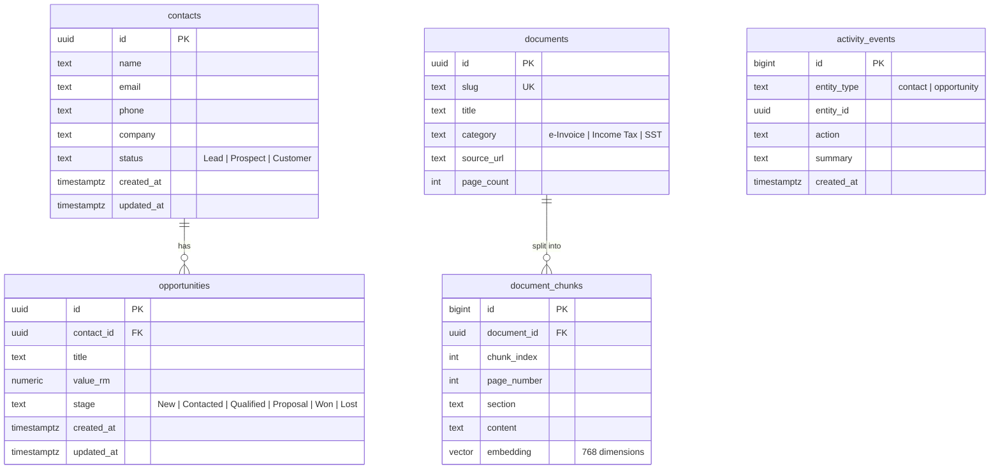

# Architecture

## 1. System components

Key points:

- **One deployable.** The Next.js app is both the frontend and the backend API. There is no separate service to run.
- **The browser never talks to Supabase or Gemini directly.** All database access and all model calls happen on the server, so the Supabase service key and the Gemini key never reach the client.
- **Ingestion is offline.** Parsing and embedding documents is a one-off batch job, so it is a CLI script rather than a web request. It shares the embedding and chunking code with the app.

## 2. Stack choice

The brief's preferred stack is used as given, so there is nothing unusual to justify: TypeScript, Next.js with React, Supabase Postgres with pgvector.

| Choice | Why |
|---|---|
| Next.js App Router, server components and server actions | CRM pages are simple reads and form posts. Server actions remove the need for a hand-written REST layer for CRUD |
| Supabase Postgres + pgvector | CRM rows and vectors live in one database: one connection, one backup, SQL joins between chunks and document metadata |
| TypeScript for ingestion too (not Python) | The query path and the ingestion path must embed text identically. Sharing `gemini.ts` and `chunking.ts` guarantees that |
| Gemini via plain `fetch` (no SDK) | The brief asks for prompts, embedding calls and LLM calls to be visible. Every model call is in `src/lib/gemini.ts` with the exact request body |
| No auth | Allowed by the brief. A single hardcoded user |

## 3. Data model

Design decisions:

- **"Leads" and "contacts" are one table.** The brief names the module Leads, links opportunities to "contacts", and counts "total contacts" on the dashboard. A lead, a prospect and a customer are the same person at different points in the relationship, so `status` is a column on `contacts` and the page is called Contacts. Two tables would mean copying a row when a lead converts.
- **`activity_events` instead of the optional Activity Log.** The dashboard needs a recent activity feed, but the manual Activity Log module is optional. Every server action writes an event (created, updated, stage changed, deleted), so the feed shows real activity without the extra module. `entity_id` is not a foreign key on purpose, so the "deleted" event survives the row it describes.
- **Deleting a contact cascades to its opportunities.** An opportunity with no contact is meaningless. The UI asks for confirmation and says so.
- **Status and stage are `text` with `check` constraints**, not Postgres enums. They are just as safe and much easier to change later.
- **Row Level Security is enabled with no policies.** The server uses the service role key, which bypasses RLS. The effect is that the public anon key cannot read or write anything.

## 4. RAG design

### 4.1 Knowledge base

Seven public PDFs from the Inland Revenue Board of Malaysia (hasil.gov.my), listed in `scripts/documents.ts`:

| Category | Document |
|---|---|
| e-Invoice | IRBM e-Invoice Guideline |
| e-Invoice | IRBM e-Invoice Specific Guideline |
| e-Invoice | LHDNM e-Invoice General FAQs |
| Income Tax | Public Ruling No. 4/2024: Taxation of a Resident Individual |
| Income Tax | Public Ruling No. 2/2025: Group Relief for Companies |
| Income Tax | Public Ruling No. 1/2025: Tax Treatment of Malaysian Ship |
| Income Tax | Public Ruling: Pre-Operational Business Expenditure |

No SST guide is included. I could not confirm a stable direct PDF link on mysst.customs.gov.my, and I chose not to ingest a link I had not verified. The schema and manifest already support an `SST` category (see section 6).

### 4.2 Ingestion pipeline (`scripts/ingest.ts`)

| Step | Decision |
|---|---|
| Download | PDF fetched once into `data/docs/`. The file is checked for the `%PDF-` signature so an HTML error page is never ingested by mistake |
| Parse | `unpdf` (PDF.js) extracts text **page by page**. Scanned PDFs are not OCR'd; the script fails loudly if no text comes out |
| Chunk | Each page is chunked on its own, so a chunk never spans two pages and its page number is exact. Target size 2,000 characters (about 500 tokens) with 200 characters of overlap, split at paragraph, then sentence, then line boundaries |
| Section | Numbered headings (for example `2.3.1 Pre-Submission`) are detected by regex and carried forward as the chunk's `section`. This is best effort |
| Embed | Gemini embedding model, task type `RETRIEVAL_DOCUMENT`, 768 dimensions, in batches of 20. The document title and section are prefixed to the chunk text before embedding so each chunk carries its context |
| Store | One `documents` row plus `document_chunks` rows. Embedding happens before any database write, and a failed insert removes the document, so there are no half-ingested documents |
| Re-runs | Idempotent. Already-ingested documents are skipped; `--force` and `--only` re-ingest |

**Why 768 dimensions:** the model's default is 3,072, but pgvector's HNSW index supports at most 2,000 dimensions. 768 is one of the sizes Google recommends for this model. Truncated vectors are re-normalised in `gemini.ts` because only the full-size output is unit length.

**Why 2,000 characters:** tax guidance is written in numbered paragraphs with worked examples. Chunks need to be big enough to keep a rule together with its conditions, and small enough that five of them fit comfortably in the prompt and each one is about a single topic.

### 4.3 Vector store and index

- `document_chunks.embedding vector(768)` with an **HNSW** index using **cosine** distance (`vector_cosine_ops`).
- Search goes through the SQL function `match_chunks(query_embedding, match_count, filter_category)`, which joins chunks to their document so every result carries the title, category, URL, page and section.

### 4.4 Retrieval (`src/lib/rag.ts`)

1. **Embed the question** with task type `RETRIEVAL_QUERY`.
2. **Top-k similarity search:** the 20 nearest chunks from pgvector.
3. **Metadata filter (bonus):** if the user picks a category in the UI, `match_chunks` restricts the search to documents in that category.
4. **Rerank (bonus):** one Gemini call (to `GEMINI_RERANK_MODEL`, which defaults to the chat model) scores each of the 20 candidates from 0 to 10 for how directly it answers the question, returned as schema-constrained JSON. The best 5 go to the answer step. If the rerank call fails, the pipeline falls back to vector order rather than failing the request.

Settings (`RAG_CANDIDATES=20`, `RAG_TOP_K=5`, `RAG_MIN_SIMILARITY=0.45`) are environment variables.

### 4.5 Prompt design

Both prompts are constants in `src/lib/rag.ts` (`RERANK_SYSTEM_PROMPT`, `ANSWER_SYSTEM_PROMPT`). The answer prompt:

- restricts the model to the numbered sources in the message;
- requires a `[n]` marker after every factual statement;
- requires rates, dates, thresholds and deadlines to appear in the sources;
- tells the model to set `answerable: false` when the sources do not contain the answer;
- tells the model that source text is reference material, not instructions (a basic prompt-injection defence for ingested content).

Output is structured JSON (`answerable`, `answer`, `citations`) enforced with Gemini's `responseSchema`, at temperature 0.

### 4.6 Citations

Each source is passed to the model as `[n] Document title (page P, section "S")` followed by the chunk text. The `[n]` markers in the answer are mapped back to the chunk metadata in code, so the document name and page shown to the user come from the database, not from text the model generated. Each citation links to the source PDF at that page (`#page=N`) and shows a snippet of the passage.

### 4.7 Hallucination guard

Three independent layers:

1. **Similarity floor.** If the best match is below `RAG_MIN_SIMILARITY`, the system refuses before calling the LLM at all.
2. **Model self-report.** The model must return `answerable: false` when the sources do not cover the question.
3. **Citation validation.** Cited numbers must exist in the context. An "answerable" reply with no valid citation is treated as a refusal, and markers pointing at sources that were never supplied are stripped.

In every refusal the user sees a fixed message saying the answer was not found in the documents.

### 4.8 Error handling

| Failure | Behaviour |
|---|---|
| Gemini 429 (per-minute) or 5xx | Retried with exponential backoff (2s up to 32s). If it still fails, the API returns 429 with a "try again in a minute" message |
| Gemini daily quota exhausted | Not retried, since it cannot recover in seconds. The user is told the quota is used up and when it resets. The evaluation saves progress after each question and can `--resume` |
| Rerank call fails or returns unusable JSON | Fall back to vector order; the UI shows "vector order" in retrieval details |
| Model returns invalid JSON or empty text | Clear error to the user; nothing is guessed |
| Empty or over-long question | 400 with a plain message |
| No documents ingested | "Not found" answer, and the page tells the user to run `npm run ingest` |
| Download blocked during ingestion | Error names the URL and the exact local filename to save it under |
| Supabase misconfigured | Pages show the error and point at `.env.local` and `schema.sql` |

## 5. Evaluation

`npm run eval` runs the 10 questions in `eval/questions.json` through the real pipeline: 9 in-scope questions, each with its expected source document(s), and 1 out-of-scope question that should be refused. A hit means at least one of the top 5 chunks comes from an expected document. Full per-question output, including every answer, is in `eval/results.md` and `eval/results.json`.

### Results

Models: `gemini-embedding-001` (768 dimensions) for retrieval, `gemini-3.6-flash` for reranking and answers. top-k 5, 20 rerank candidates, similarity floor 0.45.

<!-- EVAL_TABLE_START -->
| Metric | Result |
|---|---|
| Retrieval hit rate @5, vector only | 8/8 (100%) |
| Retrieval hit rate @5, with rerank | 8/8 (100%) |
| MRR, vector only | 1.0 |
| MRR, with rerank | 1.0 |
| Answered and cited an expected document | 8/8 (100%) |
| Out-of-scope question refused | not yet run |

**Run status:** 8 of 10 questions completed. The run stopped at q9 when the free-tier daily quota for the chat model ran out (see section 4.8); q9 and q10 are pending.
<!-- EVAL_TABLE_END -->

### What the results show

- **Document-level retrieval is easy for this set.** Every in-scope question found an expected document at rank 1, with or without reranking, and best-match similarity was between 0.74 and 0.79. With seven documents on clearly different topics, that is expected, and it means the hit rate alone does not separate good retrieval from adequate retrieval.
- **Reranking changes which page comes first, not which document.** In 4 of the 8 questions (q2, q3, q7, q8) the reranker promoted a different page to the top. In q2, vector search ranked page 49 of the Specific Guideline first; the reranker moved page 18, which states the consolidation rule, to the top and pulled in the matching FAQ answer. A document-level metric cannot capture this, which is why the next improvement to the evaluation is expected pages, not just expected documents.
- **Overlapping sources are used together.** The three e-Invoice documents cover some of the same ground, and answers routinely cite more than one of them (q1, q2, q3, q5). That is why several questions accept more than one expected document.
- **Answers are grounded and specific.** Answers quote concrete figures from the sources with page citations, for example the 72-hour window for rejection or cancellation (q1) and the seven calendar days after month end for consolidated e-Invoices (q2). Spot-checking cited pages against the PDFs is part of the manual checks listed in AI_USAGE.md.
- **Limits of this evaluation.** Ten questions written from the documents' titles and contents pages are a smoke test, not a benchmark. The questions were not adversarial, there is only one out-of-scope question, and answer correctness is checked by hand rather than automatically. The similarity floor of 0.45 is well below every in-scope best match (0.74 or higher), so it only catches clearly unrelated questions; questions that are on-topic but unanswered rely on the second and third guards.

## 6. What I would do differently with more time

- **Add SST documents.** taxPOD covers SST, and the knowledge base currently does not. The category already exists in the schema.
- **Hybrid search.** Tax questions often hinge on exact terms (section numbers, form names such as "SST-02", ruling numbers). Combining pgvector with Postgres full-text search would catch what embeddings miss.
- **Structure-aware chunking.** Chunks are split by size within a page. Splitting on the documents' own numbered paragraphs and keeping each worked example whole would be better, and tables currently come out as flattened text.
- **Document versioning.** The e-Invoice guidelines are revised several times a year at the same URL. The pipeline should record the version and publication date, detect changes, and show the version in every citation.
- **A stronger evaluation.** Ten questions is a smoke test. I would add more questions, expected pages rather than just expected documents, and an answer-faithfulness check.
- **Plan for quotas from the start.** The free tier allows a small number of requests per model per day, and the first evaluation run used them all up partway through. Each question now costs 2 LLM requests instead of 3, and the reranker can run on a separate, lighter model. In production I would use a paid tier and cache answers to repeated questions.
- **A dedicated reranker.** The LLM rerank adds a model call and latency to every question. A cross-encoder reranking model would be faster and cheaper.
- **Streaming answers** and conversation history in the assistant, which is currently single-turn.
- **Link the assistant to the CRM**, for example asking a tax question in the context of a specific contact.
- **Tests and auth.** Unit tests for chunking and the citation guard, end-to-end tests for the CRM flows, and real authentication with per-user RLS policies.
- **Editing UX.** Edit forms use query parameters and full page navigation. Inline editing or a modal would be smoother.
